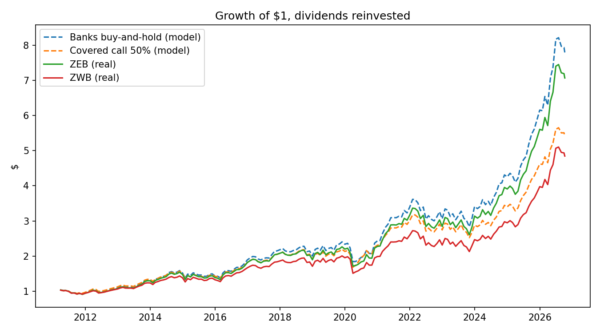
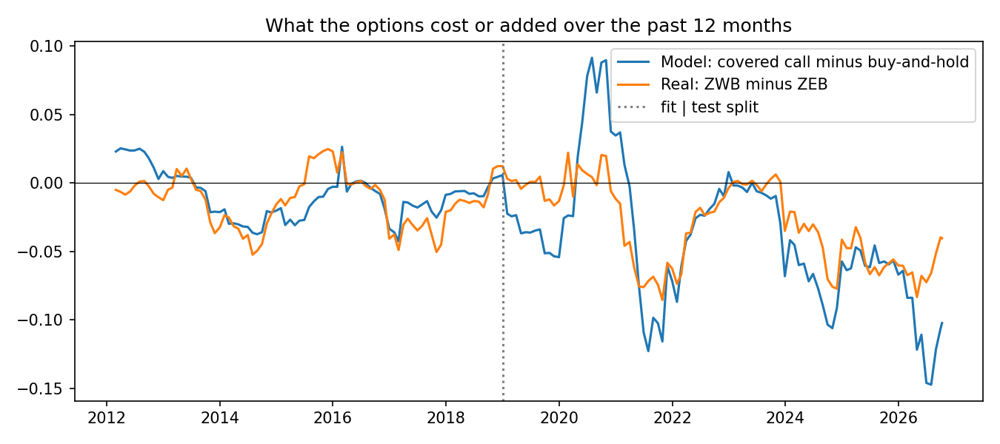
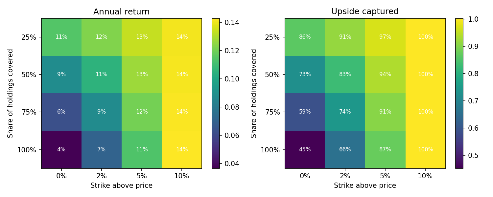

# Are covered-call bank ETFs worth it?

Covered-call ETFs are popular with Canadians who want income. They hold stocks and sell call options on them, then pay the option premium out as extra distributions. The cost is that when the stocks rally past the strike, the gain goes to whoever bought the call.

This study asks whether that trade has been worth it for Canadian bank stocks, and how the design of the strategy changes the answer. It compares two BMO ETFs that hold the same six banks:

- **ZEB**: BMO Equal Weight Banks ETF, no options
- **ZWB**: BMO Covered Call Canadian Banks ETF, which sells calls on about half of the holdings

It then rebuilds the strategy from scratch, using the Black–Scholes pricer from this repo (extended for dividends), to test design choices the real ETF cannot show.

## Short answer

Data: March 2011 to October 2026, 188 months, total returns with distributions reinvested.

1. **Higher income, lower total return.** ZWB paid about 5.6% in distributions over the last 12 months, against 2.4% for ZEB. Over the full period, though, ZEB returned 13.3% a year and ZWB 10.6%: $1 grew to $7.07 in ZEB and $4.84 in ZWB. Only about 0.4 points a year of that gap is ZWB's higher fee. The rest is the cost of the calls.
2. **The cost shows up in strong years, and the protection in weak years is small.** In the seven years when ZEB gained more than 15%, ZWB lagged by 5.4 points on average (8.6 points in 2021, 8.5 in 2025). In the four down years it was ahead by only 0.6 points. In March 2020 it fell further than ZEB (−21.2% vs −18.2%), and its worst drawdown was no better (−24.7% vs −24.2%).
3. **In a rebuilt version, the strike matters more than the coverage.** More income always meant less total return. Writing at-the-money calls on all holdings brought in about 18% a year in premium but cut the return from 14.0% to 3.7%. Writing 10% out of the money kept almost all of the upside, but brought in less than 1.5%.
4. **Whether covered calls improve risk-adjusted return depends on one number nobody gives away for free:** how much option buyers overpay, meaning implied volatility above realized volatility. If implied volatility is at least 2 points above realized, the rebuilt strategy beats buy-and-hold on Sharpe ratio; at zero or below, it does not. Matching the model to ZWB favours zero or below, which agrees with ZWB's own lower Sharpe ratio, but cannot pin the number down precisely.

## Method

**Data.** Daily prices and dividends from Yahoo Finance for RY, TD, BNS, BMO, CM, NA, ZEB and ZWB (`fetch_data.py`). Raw data is not committed; run the script to download it.

**Rebuilt strategy** (`cc/strategy.py`). At each month-end, hold the six banks in equal weight. On a chosen share of each holding, sell a one-month call struck a chosen distance above the price. Price each call with Black–Scholes using:
- the stock's realized volatility over the last 3 months, plus an adjustment for how much implied volatility differs from it;
- the stock's trailing 12-month dividend yield, since banks pay 4–5% and ignoring it would overprice the calls;
- a 3% risk-free rate, and a 5% haircut on the premium for the bid–ask spread.

At the next month-end, keep the premium plus interest, and pay out max(S − K, 0). Everything at a rebalance date uses only information available on that date.

**Checking it against the real ETF** (`cc/validate.py`). Historical option prices are not freely available, so the volatility adjustment and the strike distance are unknowns. To estimate them honestly:
- Compare gaps, not levels: the rebuilt "covered call minus buy-and-hold" against the real "ZWB minus ZEB", with ZWB's extra 0.44% fee added back. This cancels most of what the two ETFs share.
- Choose the two settings that best match the real gap from 2011 to 2018 only, then judge them on 2019 to 2026.

## Results

### Real ETFs

| | Annual return | Volatility | Sharpe (rf 2%) | Max drawdown | Upside capture | Downside capture |
|---|---|---|---|---|---|---|
| ZEB (no options) | 13.3% | 15.1% | 0.77 | −24.2% | 99% | 102% |
| ZWB (covered call) | 10.6% | 13.7% | 0.66 | −24.7% | 86% | 95% |

Capture is measured against the equal-weight banks basket. ZWB's lower volatility came from giving up good months, not from losing less in bad ones.



### How well the rebuild matches ZWB

| | Fit period (2011–2018) | Test period (2019–2026) |
|---|---|---|
| Correlation of monthly gaps, model vs real | 0.70 | 0.70 |
| Average yearly gap, model | −0.6% | −4.6% |
| Average yearly gap, real (fee-adjusted) | −1.0% | −3.3% |

Best-fitting settings: strike 3% above the price, implied volatility 2 points below trailing realized volatility. The model picks up the same pattern as the real ETF, including the jump in the cost of the calls after 2021, but it overstates the cost in the test period by about 1.3 points a year.



The clearest miss is 2020. After the March crash, trailing realized volatility stayed very high for months, so the model priced the calls it sold as very expensive and "earned" large premiums. The real ETF did not. Trailing volatility reacts late; real implied volatility fell faster once markets calmed.

### Design choices

Annual return and share of upside kept, for different coverage and strike distances, using the fitted volatility setting:



Full table in `results/design_grid.csv`. The pattern is monotonic: every extra point of option income was paid for with total return, and strike distance mattered more than coverage.

### Sensitivity to the volatility assumption

50% coverage, 3% out of the money. Buy-and-hold: 14.0% a year, Sharpe 0.82.

| Implied minus realized vol | Premium income | Annual return | Sharpe |
|---|---|---|---|
| −4 points | 2.7% | 10.6% | 0.69 |
| −2 points (fitted) | 3.4% | 11.4% | 0.75 |
| 0 | 4.2% | 12.3% | 0.81 |
| +2 points | 5.2% | 13.4% | 0.89 |
| +4 points | 6.3% | 14.6% | 0.97 |

At a 3% strike, the fit to ZWB was almost equally good anywhere from −6 to 0 points, and got clearly worse from +2 upward (`results/calibration_grid.csv`). So the ETF data argues against a volatility premium large enough to make the strategy win on Sharpe ratio, in line with ZWB's own Sharpe of 0.66 against ZEB's 0.77. It cannot say exactly where in the −6 to 0 range the truth is.

## Limitations

- **No historical option prices.** Calls are priced with Black–Scholes and an assumed volatility, which is the main source of model error. Real option quotes, for example from the Montréal Exchange, would replace this assumption.
- **Trailing volatility lags.** After sudden market moves, the model's volatility estimate is out of date for weeks or months (see 2020).
- **One sector, one period.** Canadian banks rallied strongly in 2021 and 2024–2026, the worst environment for selling calls. A flatter decade could look different.
- **Simplified ETF mechanics.** ZWB's actual strikes, expiries and timing are not published month by month; the rebuild uses one-month calls written at month-end.
- 2011 and 2026 are partial years. Sharpe ratios use a flat 2% risk-free rate.

## Run it

```bash
pip install yfinance pandas numpy matplotlib
python fetch_data.py          # downloads to data/
python run_study.py           # writes tables and charts to results/
python -m unittest discover tests
```

`run_study.py` options: `--split` (fit/test boundary, default 2019-01-01), `--rf` (risk-free rate for Sharpe, default 2%), `--fee-gap` (ZWB minus ZEB expense ratio, default 0.44%).

## Files

- `cc/pricing.py`: Black–Scholes call with a dividend yield
- `cc/strategy.py`: month-end data preparation and the covered-call simulation
- `cc/validate.py`: fit on early years, test on later years, against the real ETF gap
- `cc/stats.py`: return, volatility, Sharpe, drawdown, upside/downside capture
- `tests/`: 13 unit tests, including put–call parity with dividends, zero coverage equal to buy-and-hold, the cap on upside, and recovering known settings from simulated data

Fund facts: ZWB writes calls on about 50% of the portfolio ([Morningstar](https://morningstar.ca/ca/news/184509/a-bank-stock-strategy-for-income-oriented-investors.aspx)); expense ratios ZEB 0.28%, ZWB 0.72% ([Cboe Canada](https://etfmarket.cboe.com/canada/en/etf-comparison/ZEB-vs-ZWB)). This is a study of past data, not investment advice.
